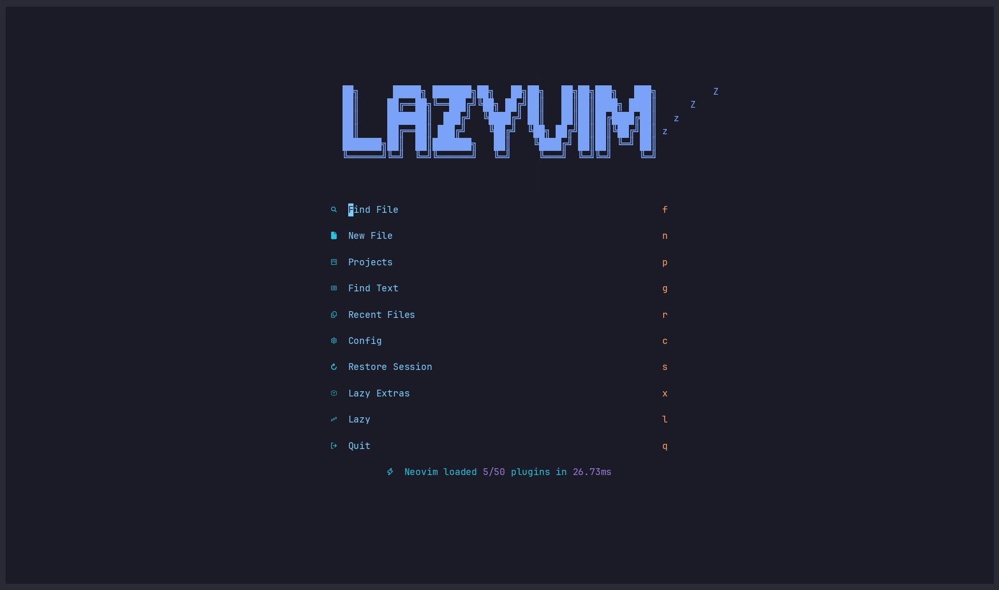

# 🗺️ trailmap.nvim

**Ask your codebase a question. Get back the code that answers it.**

You've been there. The project started small, you knew every file. Then it grew:
new features, new teammates, a few rewrites, a `utils/` folder nobody wants to open.
Now it's a black box. Somebody asks *"what actually happens when a user clicks
Checkout?"* and you spend half an hour grepping, jumping to definitions, and keeping
twelve buffers in your head.

What if you could just **ask**, and see the answer the way you already review code:
as a diff-style file tree, with exactly the lines that matter highlighted?

```vim
:Trailmap how does checkout create an order?
```



## ✨ What you get

- **Answers, not search results.** An AI agent ([Claude Code](https://claude.com/claude-code)
  or [Codex](https://github.com/openai/codex)) follows the flow end to end, from UI
  trigger to hook to server action to API call, and hands back only the ranges that matter.
- **A view you already know.** A [diffview](https://github.com/sindrets/diffview.nvim)-style
  file tree on the left, your real source buffers in the middle. LSP, treesitter, and
  your keymaps all keep working, because it *is* your code, not a copy.
- **Every line explained.** Each range is highlighted, gets a sign, and carries a short
  note on why it's there.
- **A conversation, not one shot.** The agent runs in an interactive terminal on the
  right. Ask *"and what about refunds?"* and the map redraws in place.
- **Walk it like a story.** `<Tab>` to the next file, `]s` to the next range, `gq` to dump
  the whole trail into quickfix.
- **Faster with [CodeGraph](https://github.com/colbymchenry/codegraph).** When the repo is
  indexed, the agent uses the symbol graph to find things in one hop. No index? It falls
  back to plain file search.

## 💡 Questions worth asking

```vim
:Trailmap where do we validate the JWT and what happens when it's expired?
:Trailmap how does a new user get their default settings?
:Trailmap what writes to the orders table?
:Trailmap why does the dashboard fetch the profile twice?
:Trailmap how is the websocket connection retried?
```

Great for onboarding onto a new repo, reviewing a feature you didn't write, planning a
refactor, or remembering what past-you was thinking.

## 📦 Requirements

- Neovim 0.11+
- [`claude`](https://claude.com/claude-code) and/or [`codex`](https://github.com/openai/codex) on `$PATH`
- Optional: [`codegraph`](https://github.com/colbymchenry/codegraph) with the repository indexed
- Optional: [mini.icons](https://github.com/echasnovski/mini.icons) or
  [nvim-web-devicons](https://github.com/nvim-tree/nvim-web-devicons) for file icons

## 🚀 Installation

[lazy.nvim](https://github.com/folke/lazy.nvim):

```lua
{
  "pialechini/trailmap.nvim",
  cmd = { "Trailmap", "TrailmapAgent" },
  keys = {
    { "<leader>sT", "<cmd>Trailmap<cr>", desc = "Trailmap: ask about the code" },
  },
  opts = {},
}
```

Then open a project and run `:Trailmap`. That's it.

## ⌨️ Usage

| Command | |
| --- | --- |
| `:Trailmap [question]` | Start a session (prompts for the question when omitted) |
| `:TrailmapAgent [claude\|codex]` | Show or switch the agent for this Neovim session |
| `:TrailmapClose` | Stop the agent and close the tab |
| `:TrailmapFocus` | Jump to the file panel |

**File panel**

| Key | |
| --- | --- |
| `j` / `k` | Move; landing on a file previews it |
| `<CR>` / `o` | Open file / toggle directory |
| `p` | Preview file |
| `l` / `h` | Expand / collapse |
| `zo` / `zc` / `za` | Open / close / toggle directory |
| `zR` / `zM` | Expand / collapse all |
| `<Tab>` / `<S-Tab>` | Next / previous file |
| `gq` | Send all ranges to the quickfix list |
| `q` | Close |

Mouse works too: click to preview, double-click to open.

**Source window**

| Key | |
| --- | --- |
| `]s` / `[s` | Next / previous range |
| `<Tab>` / `<S-Tab>` | Next / previous file |
| `<leader>ee` | Focus the panel |

**Agent terminal**

| Key | |
| --- | --- |
| `<C-h>` `<C-j>` `<C-k>` `<C-l>` | Move to the neighbouring window |

## ⚙️ Configuration

Defaults:

```lua
require("trailmap").setup({
  agent = "claude", -- "claude" | "codex"
  width = 0.12, -- agent terminal width: fraction of the editor (< 1) or columns (>= 1)
  agents = {
    claude = { cmd = "claude", model = "sonnet" },
    codex = { cmd = "codex", model = nil }, -- nil: model from ~/.codex/config.toml
  },
})
```

Highlight groups (all `default`, override freely): `TrailmapRange`, `TrailmapSign`,
`TrailmapGuide`, `TrailmapFold`, `TrailmapLoc`, `TrailmapRangeCount`, `TrailmapSelected`.

## 🔍 How it works

trailmap.nvim is a thin viewer. The agent does all the searching and double-checks its
own answer, then writes JSON to a temporary file:

```json
{ "summary": "...", "files": [{ "file": "src/a.ts", "ranges": [{ "start": 10, "end": 24, "why": "..." }] }] }
```

trailmap.nvim watches that file, checks every range against the files on disk, and
re-renders whenever the agent rewrites it. No servers, no indexing of its own, one Lua file.

## 🔒 Security

The agent runs as you, in the current working directory.

- **Claude** is pre-approved only for CodeGraph, `Read`, `Grep`, `Glob`, and writing the
  result file; anything else asks for permission in the terminal.
- **Codex** starts in the `workspace-write` sandbox, so it can edit files in the
  repository. The prompt tells it not to, but review what it does.

## License

[MIT](LICENSE)
